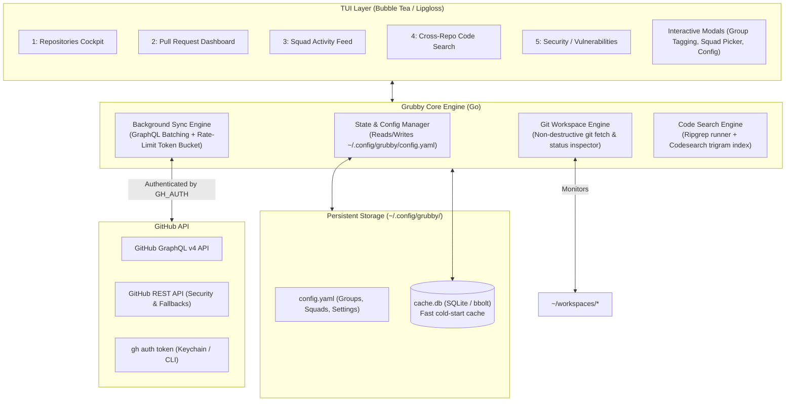

# Grubby Specification (v2.0)

Grubby is a high-performance Terminal User Interface (TUI) cockpit for developers interacting with GitHub across multiple repositories, squads, and local workspaces.

It merges **remote GitHub state** (pull requests, review comments, team activity, vulnerability alerts) with **local developer reality** (cloned workspaces, branch status, ahead/behind tracking, and instant cross-repo code search).

---

## 1. System Architecture

Grubby is built in **Go** using a local-first, event-driven architecture designed to minimize latency and respect GitHub API rate limits.



### 1.1 Key Principles
1. **Instant Startup (Local-First)**: Renders the TUI within 50ms from local SQLite cache; never blocks UI thread on network calls.
2. **Rate-Limit Preservation**: Aggressive batching using GitHub GraphQL v4, ETags/conditional requests, and rate-limit budgeting.
3. **Non-Destructive Git Safety**: Background synchronization only executes network `git fetch --prune`. It never executes unprompted merges or rebases that could cause conflicts or touch dirty working trees.
4. **Interactive Persistence**: User actions inside the TUI (adding repos to groups, creating squads, adding squad members) immediately write back to `~/.config/grubby/config.yaml`.

---

## 2. Core Domain Models

### 2.1 Repositories & Dynamic Groups
* **Many-to-Many Grouping**: A repository can belong to zero, one, or multiple groups (e.g., `repo-api` belongs to `["backend", "payments", "core-services"]`).
* **Interactive UI Tagging**:
  * Selecting a repo and pressing `g` opens the **Group Management Modal**.
  * Users can toggle existing groups on/off or type a new group name on the fly.
  * Changes are immediately committed to `~/.config/grubby/config.yaml`.
* **Group Filtering**: In the Repos and PR views, hitting `ctrl+g` cycles through available groups or opens a fuzzy group filter.

### 2.2 Squads & Watched Squad Flow
* **Multi-Squad Management**: Users can define multiple squads (e.g., `Checkout Squad`, `Core Infra`, `Frontend Guild`).
* **Squad Composition**:
  * Members are identified by their GitHub usernames.
  * Can be seeded from GitHub Team slugs (`org/team-slug`) or created manually.
* **Interactive Member Management**:
  * Pressing `a` in the Squad view prompts to add a GitHub user directly to the active squad.
  * Persisted immediately to `~/.config/grubby/config.yaml`.
* **Watched Squad Concept**:
  * The user designates one squad as the **Active/Watched Squad**.
  * The Squad Activity view and PR Squad filter automatically focus on this squad.
  * Hitting `s` in the Squad view displays a switcher modal to quickly pivot to watching a different squad.

### 2.3 Workspace Awareness
* Default workspace root: `~/workspaces/` (configurable).
* Grubby detects existing cloned directories by reading `.git/config` remotes.
* Git status classification:
  * `NOT_CLONED`: Repo exists remotely in the org, not present in local workspace.
  * `SYNCED`: Clean working tree, local default branch is up to date with remote tracking branch.
  * `BEHIND`: Clean working tree, remote has new commits (`git merge --ff-only` safe).
  * `AHEAD`: Local branch has unpushed commits.
  * `DIVERGED`: Both local and remote have diverged commits.
  * `DIRTY`: Unstaged or uncommitted working tree modifications.
  * `FEATURE_BRANCH`: Checked out on a branch other than default.

---

## 3. Screen-by-Screen TUI Specification

### View 1: Repositories Cockpit
The primary entry screen. Sorted by most recently opened / contributed to (most recent PR/commit takes precedence over last opened).

```
┌─ [1: Repositories] ── [2: PRs (6)] ── [3: Squad: Checkout] ── [4: Search] ── [5: Security] ───── Org: acme  Rate: 4,780/5,000 ─┐
│ Filter: [api-              ]  Group: [All Groups ▼]  Watched Squad: [Checkout]                                                  │
│                                                                                                                                  │
│ Repository               Groups             Git Status     Branch       Last Activity       Local Path                           │
│ ──────────────────────────────────────────────────────────────────────────────────────────────────────────────────────────────── │
│ ▶ api-gateway            backend, core      [↓ 2 behind]   main         10m ago by alice    ~/workspaces/api-gateway             │
│   api-payments           backend, pay       [✓ synced]     main         2h ago by bob       ~/workspaces/api-payments            │
│   api-billing            pay, infra         [* dirty]      feat/stripe  1d ago by you       ~/workspaces/api-billing             │
│   api-notifications      backend            [Not Cloned]   -            3d ago by charlie   -                                    │
│   api-auth               core, sec          [✓ synced]     main         5d ago by dave      ~/workspaces/api-auth                │
│                                                                                                                                  │
├──────────────────────────────────────────────────────────────────────────────────────────────────────────────────────────────────┤
│ [Enter] Open PRs  [g] Manage Groups  [c] Clone  [e] Editor  [o] Web  [u] Fast-forward  [U] Fast-forward All Safe  [?] Help      │
└──────────────────────────────────────────────────────────────────────────────────────────────────────────────────────────────────┘
```

#### Interactions & Hotkeys:
* `g`: Opens the **Manage Groups Modal** for the selected repository. Check/uncheck groups with `Space`, add new group with `+`, save with `Enter`.
* `ctrl+g`: Select active group filter (filters visible list to repos in that group).
* `c`: Clones the selected repository into `~/workspaces/{repo-name}` using `gh repo clone` or `git clone`. Starts background indexing upon completion.
* `e`: Spawns the local repository in `$EDITOR` (e.g. Neovim, VS Code).
* `o`: Opens the repository in the default web browser.
* `u`: Fast-forwards the selected repository (only if status is `BEHIND` and working tree is clean).
* `U`: Batch fast-forwards all clean `BEHIND` repositories in the active filter.

---

### View 2: Pull Request Dashboard
Focused on actionable code review: stale detection, blocking states, review comments, and Copilot reviews.

```
┌─ [1: Repositories] ── [2: PRs (6)] ── [3: Squad: Checkout] ── [4: Search] ── [5: Security] ───── Org: acme  Rate: 4,780/5,000 ─┐
│ Filter: [is:open           ]  Group: [All]  Scope: [Watched Squad ▼]  Sort: [Stalest First]                                      │
│                                                                                                                                  │
│ PR    Repo             Title                               Author    Age     Status        Unresolved  Labels                    │
│ ──────────────────────────────────────────────────────────────────────────────────────────────────────────────────────────────── │
│ ▶ #142 api-gateway      Refactor token validator            alice     5d [!]  CHANGES_REQ   💬 4/6      core, p1                  │
│   #88  api-payments     Integrate Apple Pay v2              bob       3d      REVIEW_REQ    💬 2/2      payments                  │
│   #204 api-billing      Fix tax calculation rounding error  you       1d      APPROVED      💬 0/3      bug                       │
│   #95  api-auth         Upgrade Go runtime to 1.27          charlie   6h      CI_FAILING    💬 0/0      chore                     │
│                                                                                                                                  │
├──────────────────────────────────────────────────────────────────────────────────────────────────────────────────────────────────┤
│ [Enter] View Comments & Detail  [p] Trigger Copilot Review  [o] Open Web  [c] Checkout PR Branch  [b] Squad/All Filter  [?] Help │
└──────────────────────────────────────────────────────────────────────────────────────────────────────────────────────────────────┘
```

#### Key Information Displayed:
* **Age / Stale Warning**: PRs open > 3 days without updates display a warning badge `[!]`.
* **Review & Merge Status**: `APPROVED` (green), `CHANGES_REQ` (red), `REVIEW_REQ` (yellow), `BLOCKED / MERGE_CONFLICT` (red highlight).
* **Comment Counter**: Displayed as `💬 {unresolved}/{total}`. PRs with 0 unresolved show muted styling.
* **Copilot Review Action (`p`)**:
  * Triggers a GitHub Copilot review by requesting `@github-copilot` as a reviewer or posting `/copilot review`.
  * Shows toast confirmation: `"Copilot review requested for #142"`.

---

### View 3: Squad Activity Feed
A focused timeline of what members of the watched squad are doing across the organization.

```
┌─ [1: Repositories] ── [2: PRs] ── [3: Squad: Checkout (4 members)] ── [4: Search] ── [5: Security] ─────── Org: acme ───────────┐
│ Watched Squad: [Checkout Squad ▼] (press 's' to switch)  Members: alice, bob, charlie, you                                      │
│                                                                                                                                  │
│ Time       Actor      Action     Target                                 Details                                                  │
│ ──────────────────────────────────────────────────────────────────────────────────────────────────────────────────────────────── │
│ ▶ 12m ago   alice      Opened PR  api-gateway#142                        "Refactor token validator"                               │
│   45m ago   bob        Merged PR  api-payments#87                        "Update stripe webhook handler"                          │
│   2h ago    charlie    Commented  api-gateway#142                        "Let's avoid allocating a new slice here"                │
│   3h ago    alice      Pushed     api-gateway:feat/auth-v2 (3 commits)   "fix: handle nil context in auth handler"                │
│   5h ago    bob        Approved   api-billing#204                        "Looks solid, verified edge case tests"                  │
│                                                                                                                                  │
├──────────────────────────────────────────────────────────────────────────────────────────────────────────────────────────────────┤
│ [s] Switch Squad  [a] Add Member  [d] Remove Member  [n] Create New Squad  [Enter] Inspect Item  [o] Open in Web  [?] Help       │
└──────────────────────────────────────────────────────────────────────────────────────────────────────────────────────────────────┘
```

#### Squad Management Workflows:
* `s`: Opens **Squad Selector Modal**:
  * Lists configured squads with member counts.
  * Arrow keys + `Enter` instantly switches the watched squad.
* `a`: Opens **Add Member Modal**:
  * Text input with auto-completion from org members.
  * Immediately appends member to the active squad in `config.yaml`.
* `n`: Prompts for a new squad name and initial members.

---

### View 4: Cross-Repo Code Search & Syntax Preview
Search source code across all cloned workspaces with instant structured navigation and split-pane file/line preview.

```
┌─ [1: Repositories] ── [2: PRs] ── [3: Squad] ── [4: Code Search] ── [5: Security] ──────────────── Org: acme ───────────────────┐
│ Search: [func ValidateToken                  ]  Scope: [All Cloned (18 repos) ▼]  Hits: [4 matches in 2 repos]                  │
│                                                                                                                                  │
│ Results (Tree Navigator)                            │ File Preview: api-gateway/auth/validator.go:42 (Go)                        │
│ ────────────────────────────────────────────────────┼─────────────────────────────────────────────────────────────────────────── │
│ ▼ api-gateway (3 matches)                           │ 38: // ValidateToken checks JWT signature and claims                      │
│   ▼ auth/validator.go (2 matches)                   │ 39: // against the active JWKS keyset.                                    │
│     ▶ L42: func ValidateToken(ctx context.Context  │ 40:                                                                        │
│       L118: if err := ValidateToken(ctx, refresh)   │ 41: // Claims represents the parsed JWT claims payload.                    │
│   ▶ middleware/auth.go (1 match)                    │ 42: func ValidateToken(ctx context.Context, token string) (*Claims, error)│
│ ▼ api-auth (1 match)                                │ 43:     if token == "" {                                                   │
│   ▶ pkg/token/jwt.go (1 match)                      │ 44:         return nil, ErrMissingToken                                    │
│                                                     │ 45:     }                                                                  │
│                                                     │ 46:     claims, err := parseAndVerify(ctx, token)                          │
├─────────────────────────────────────────────────────┴───────────────────────────────────────────────────────────────────────────┤
│ [Enter] Open in $EDITOR at line  [j/k] Navigate  [h/l/Space] Toggle Node  [Tab] Switch Pane  [/] New Search  [?] Help            │
└──────────────────────────────────────────────────────────────────────────────────────────────────────────────────────────────────┘
```

#### Search Architecture & UI Components:
1. **Left Pane: Flattened Interactive Tree Navigator**:
   * Hierarchical tree structure: `Repository Node` → `File Node` → `Match Node (Line & Column)`.
   * Collapsible branches via `h` (collapse), `l` or `Space` (expand).
   * Moving the cursor over any `Match Node` immediately triggers a debounced live preview on the right pane.

2. **Right Pane: Viewport + Chroma Syntax Highlighter**:
   * Uses `charmbracelet/bubbles/viewport` for smooth scrolling.
   * Syntax highlighting powered by `alecthomas/chroma/v2` (pure Go, 200+ languages, dark terminal palette).
   * The matched line (`L42`) is rendered with an accented gutter indicator (`▶`) and distinctive background highlighting.

3. **Search Engine Provider Pattern (`Engine` Interface)**:
   * **Primary (`ripgrep --json`)**:
     * Runs `rg --json -i -e {query} {paths...}` via streaming subprocess stdout reader.
     * Parses structured JSON lines (`type: match` with file, line_number, byte submatches).
     * Automatically honors `.gitignore`, skips `.git/`, `node_modules/`, and binary files.
     * Zero-index overhead: always reflects real-time uncommitted edits and branch checkouts in under 80ms.
   * **Fallback Engine (Pure Go)**:
     * Directory walker with gitignore filtering for environments where `rg` is not on `$PATH`.

4. **Structured Data Contracts**:
   ```go
   type LineMatch struct {
       LineNumber int    `json:"line_number"`
       LineText   string `json:"line_text"`
       ColStart   int    `json:"col_start"`
       ColEnd     int    `json:"col_end"`
   }

   type FileMatches struct {
       RelPath string      `json:"rel_path"`
       AbsPath string      `json:"abs_path"`
       Matches []LineMatch `json:"matches"`
   }

   type RepoMatches struct {
       RepoName    string        `json:"repo_name"`
       RepoPath    string        `json:"repo_path"`
       FileMatches []FileMatches `json:"file_matches"`
       TotalHits   int           `json:"total_hits"`
   }
   ```

---

### View 5: Vulnerabilities & Security Dashboard
Summary view of security alerts (Dependabot, CodeQL, Secret Scanning) per repository.

```
┌─ [1: Repositories] ── [2: PRs] ── [3: Squad] ── [4: Search] ── [5: Security (14)] ─────────────── Org: acme  Rate: 4,780/5,000 ─┐
│ Filter: [                  ]  Sort: [Highest Critical + High]  Group: [All Groups]                                              │
│                                                                                                                                  │
│ Repository               Critical   High       Medium     Low        Total   Last Scanned     Action                             │
│ ──────────────────────────────────────────────────────────────────────────────────────────────────────────────────────────────── │
│ ▶ api-payments           2 [CRIT]   4 [HIGH]   1          0          7       1h ago           [Enter] Drilldown                  │
│   api-gateway            0          2 [HIGH]   3          2          7       3h ago           [Enter] Drilldown                  │
│   api-billing            0          1 [HIGH]   0          1          2       Yesterday        [Enter] Drilldown                  │
│   api-auth               0          0          2          1          3       2d ago           [Enter] Drilldown                  │
│                                                                                                                                  │
├──────────────────────────────────────────────────────────────────────────────────────────────────────────────────────────────────┤
│ [Enter] Drilldown Alert Details  [o] Open in GitHub Security tab  [r] Refresh Security Scan  [?] Help                            │
└──────────────────────────────────────────────────────────────────────────────────────────────────────────────────────────────────┘
```

#### Drilldown View:
Pressing `Enter` on a repo opens the vulnerability list showing CVE identifier, package name, vulnerable version range, fixed version, and direct link to the advisory.

---

## 4. Configuration Specification (`~/.config/grubby/config.yaml`)

Grubby maintains full read/write synchronization with its configuration file. When the user modifies groups or squads in the TUI, Grubby updates this file atomically.

```yaml
version: 1
default_org: "acme-corp"
workspace_dir: "~/workspaces"
editor: "nvim" # or "code", fallback to $EDITOR

# The currently watched squad
active_squad: "checkout-squad"

# Squad definitions (custom squads or mapped from GitHub teams)
squads:
  - name: "checkout-squad"
    display_name: "Checkout Squad"
    github_team: "acme-checkout" # optional GitHub team sync
    members:
      - "alice"
      - "bob"
      - "charlie"
      - "simonbronner"

  - name: "platform-squad"
    display_name: "Platform Infra"
    members:
      - "dave"
      - "eve"

# Repository groupings (many-to-many)
groups:
  - name: "payments"
    display_name: "Payments Solution"
    repos:
      - "api-payments"
      - "api-billing"
      - "payment-worker"

  - name: "core-services"
    display_name: "Core Platform"
    repos:
      - "api-gateway"
      - "api-auth"
      - "api-payments"

search:
  engine: "ripgrep" # options: "ripgrep" | "codesearch"
  ignore_dirs:
    - ".git"
    - "node_modules"
    - "vendor"
    - "dist"
    - "build"

cache:
  db_path: "~/.config/grubby/cache.db"
  ttl_minutes: 10
  auto_fetch_interval_minutes: 15
```

---

## 5. GitHub API & Rate-Limiting Strategy

### 5.1 Authentication
* Grubby inspects authentication via `gh auth token`.
* If not authenticated or token is missing, Grubby exits with a clean instructional error:
  ```
  [ERROR] GitHub authentication not found.
  Please run: gh auth login --scopes repo,read:org
  ```

### 5.2 GraphQL Batched Ingestion
Instead of issuing hundreds of REST requests, Grubby issues consolidated GraphQL queries that fetch repositories, open PRs, review comment counts, and CI statuses in a single network round-trip.

#### Example Batch Query Schema:
```graphql
query SyncOrgData($org: String!, $cursor: String) {
  organization(login: $org) {
    repositories(first: 50, after: $cursor, orderBy: {field: PUSHED_AT, direction: DESC}) {
      pageInfo { hasNextPage endCursor }
      nodes {
        id
        name
        pushedAt
        defaultBranchRef { name }
        pullRequests(states: OPEN, first: 20, orderBy: {field: UPDATED_AT, direction: DESC}) {
          nodes {
            number
            title
            author { login }
            createdAt
            updatedAt
            isDraft
            mergeable
            reviewDecision
            labels(first: 5) { nodes { name color } }
            reviewThreads(first: 30) {
              totalCount
              nodes { isResolved }
            }
          }
        }
      }
    }
  }
}
```

### 5.3 Graceful Degradation for Security Alerts
* REST endpoint `/repos/{owner}/{repo}/dependabot/alerts` requires specific permissions.
* If a 403 or 404 response is returned, Grubby records status `PERMISSION_DENIED` or `DISABLED` for that repo and continues without crashing.

---

## 6. Implementation Milestones

### Phase 1: MVP Core Cockpit
- [ ] Config loader & YAML writer (`~/.config/grubby/config.yaml`).
- [ ] `gh auth` credential validation.
- [ ] GraphQL query runner with SQLite caching (`~/.config/grubby/cache.db`).
- [ ] Bubble Tea base layout with tabs: `1: Repositories` and `2: Pull Requests`.
- [ ] Clone repository to `~/workspaces/{repo}` action (`c`).

### Phase 2: Dynamic Groups & Workspace Intelligence
- [ ] Interactive Group Management Modal (`g`) with YAML persistence.
- [ ] Local workspace scanner (detects git remotes in `~/workspaces/*`).
- [ ] Background safe `git fetch --all --prune` worker.
- [ ] Branch status calculation (`SYNCED`, `BEHIND`, `DIRTY`, etc.).
- [ ] Fast-forward action (`u` / `U`).

### Phase 3: Squad Management & PR Deep-Dive
- [ ] Multi-squad support with active "watched squad" selection (`s`).
- [ ] Interactive "Add user to squad" modal (`a`) with YAML persistence.
- [ ] Squad Activity timeline view.
- [ ] Stale PR calculation (>3 days threshold) and unresolved comment counter (`💬 x/y`).
- [ ] Trigger GitHub Copilot review action (`p`).

### Phase 4: Cross-Repo Search & Security
- [ ] Ripgrep streaming runner with file/line live preview.
- [ ] Freshness indicators for indexed vs stale workspaces.
- [ ] Dependabot and CodeQL vulnerability dashboard with sorting by severity.
- [ ] Comprehensive keybinding help overlay (`?`).
